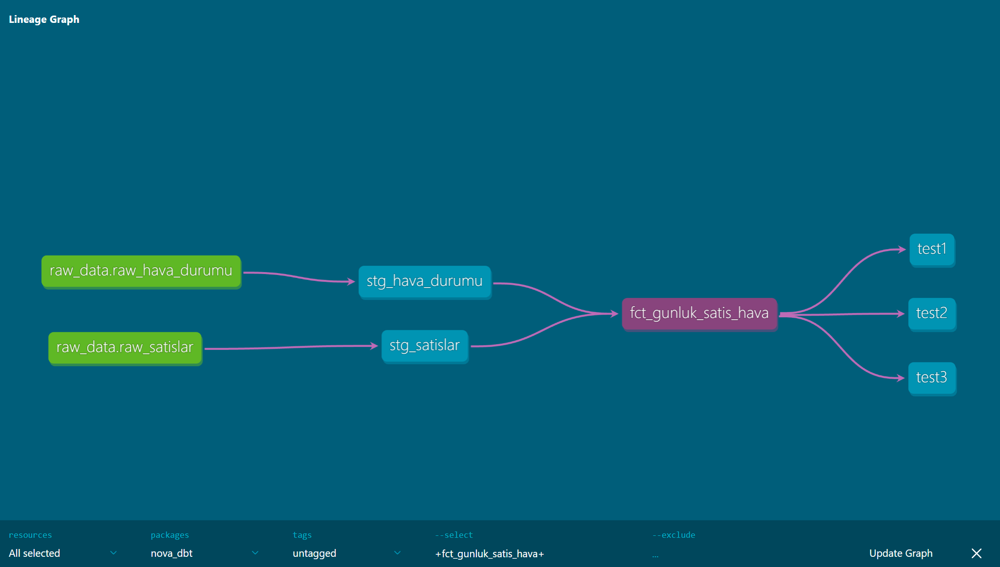
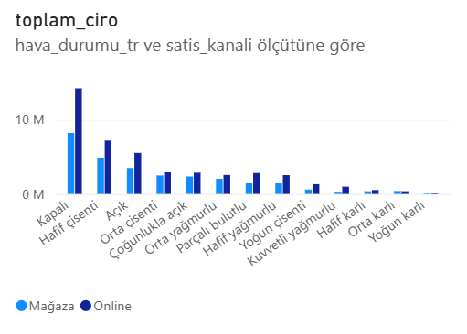
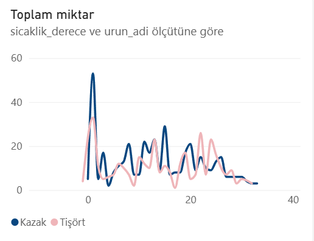

# 🛒 Hava Koşullarının Satış Kanalları ve Ürün Talebine Etkisi: Modern ELT & İş Zekası Mimarisi

Bu proje, perakende satış verileri ile harici açık kaynak meteoroloji verilerini **Modern Veri Yığını (MDS - Modern Data Stack)** yaklaşımıyla birleştiren uçtan uca bir analitik veri mühendisliği ve iş zekası çalışmasıdır.

---

##  Proje Mimarisi ve Teknoloji Yığını

- **Veritabanı Motoru:** DuckDB (`dev.duckdb`)
- **Dönüşüm & Modelleme (Transform):** dbt Core (`dbt-duckdb`)
- **Veri Kalitesi & Testler:** dbt test & singular tests
- **Veri Görselleştirme & Dashboard:** Microsoft Power BI Desktop
- **Geliştirme & Sorgulama:** VS Code, DBeaver

---

##  Veri Boru Hattı ve Veri Soyağacı (Lineage DAG)

Projede ham veri kaynağından mart katmanına kadar olan akış modüler staging ve mart yapılarıyla kurgulanmıştır.

1. **Source Katmanı:** `raw_satislar` ve `raw_hava_durumu`
2. **Staging Katmanı:** 
   - `stg_satislar.sql`: Karakter setlerinin düzenlenmesi, 2024 yılı filtrelemesi ve sayısal tip dönüşümleri.
   - `stg_hava_durumu.sql`: Günlük sıcaklık ve yağış özetlerinin normalize edilmesi.
3. **Marts Katmanı:**
   - `fct_gunluk_satis_hava.sql`: Şehir ve tarih bazında birleştirilmiş, zaman boyutları (`hafta_sonu_mu`, `gun_adi`) ile zenginleştirilmiş nihai analitik fact tablosu.

---

##  Veri Kalitesi ve Tutarlılık Testleri

Proje genelinde veri tutarlılığını garanti altına almak amacıyla **7 adet dbt testi** uygulanmış ve tümü başarıyla geçmiştir (`PASS=7`):

- **Şema Testleri (`test_marts.yml`):** `unique`, `not_null`, `accepted_values` (Satış kanalları doğrulaması).
- **Mantıksal İş Testleri (`tests/`):**
  - `assert_pozitif_finansal_degerler.sql`: Negatif ciro/kâr oluşumunun engellenmesi.
  - `assert_gecerli_indirim_araligi.sql`: %0 - %100 arası indirim oranlarının doğrulanması.
  - `assert_makul_hava_sicakligi.sql`: Ekstrem/mantıksız sıcaklık değerlerinin kontrolü.

---

##  İş Zekası (Power BI) Bulguları

### 1. Genel Finansal Özet
Dönem boyunca incelenen toplam ciro hacmi **72 Milyon ₺** olarak kaydedilmiştir.

---

### 2. Hava Durumu ve Satış Kanalı Dağılımı
Hava durumu kırılımında tüketici davranışlarının çevrim içi ve fiziksel mağaza tercihleri incelenmiştir.

- **Online Kanal Dominasyonu:** İncelenen tüm hava koşullarında dijital kanal fiziksel mağazanın belirgin şekilde önündedir.
- **Evde Kalma Etkisi:** Ciro zirvesi **Kapalı** ve **Hafif Çisentili** günlerde gerçekleşmektedir (Kapalı havada online ciro 14M ₺'yi aşmaktadır).
- **Ekstrem Hava Şartları:** Şiddetli yağmur ve kar yağışı durumunda talep hem fiziksel hem de teslimat/kargo endişeleri nedeniyle dijital kanalda belirgin şekilde yavaşlamaktadır.

---

### 3. Sıcaklık Değişkeninin Ürün Talebine Etkisi (Mevsimsellik)
Sıcaklık artışının kışlık (**Kazak**) ve yazlık (**Tişört**) ürün talebi üzerindeki etkisi analiz edilmiştir.

- **0°C – 15°C:** Kazak satışları 0°C bandında zirve yapmakta ve soğuk/serin havalarda Tişört satışlarının belirgin biçimde üzerinde seyretmektedir.
- **20°C ve Üzeri:** 20°C eşiği aşıldığında Tişört talebi ivmelenerek Kazak satışlarını geride bırakmaktadır.

---
